<div align="center">


# Auto Job

**Your job applications, done in minutes instead of hours, and never sent without your say-so.**

A Chrome / Arc extension and a small local server that read a job posting, tailor a one-page ATS-friendly resume and cover letter for it, fill every page of the application form, and stop at the final Submit so you can review.

`Chrome` · `Arc` · `Edge` · `Brave` · `Gemini` · `Ollama` · `OpenAI-compatible` · `Claude` · `Node.js` · `Manifest V3`

</div>

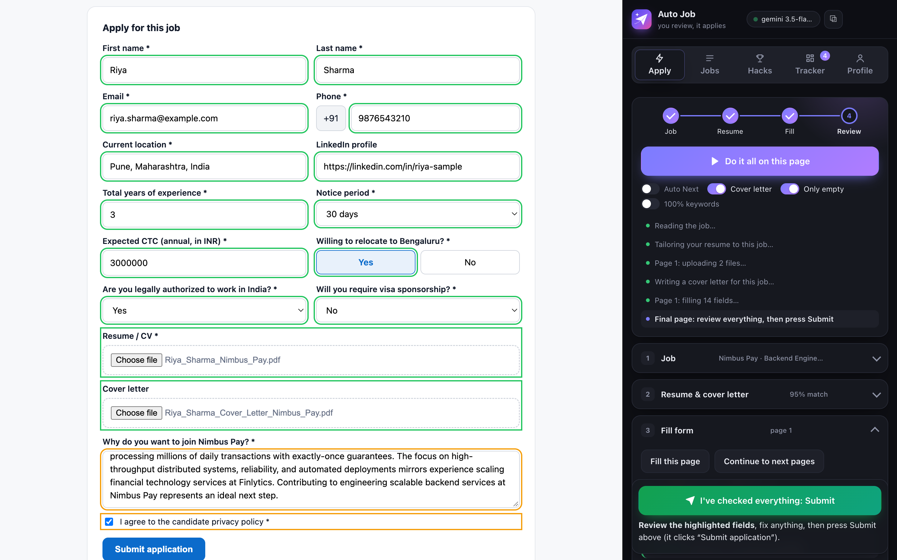

<sub>One press of **Do it all on this page**. Auto Job read the job, tailored a resume (95% keyword match) and a cover letter, uploaded both, filled all 14 fields and stopped for review. Green = from your profile. Orange = written by AI or a consent box, please check. (Demo profile: "Riya Sharma" is made up.)</sub>

---

## Contents

- [Why Auto Job](#why-auto-job)
- [What it does](#what-it-does)
- [Tour](#tour)
- [How it works](#how-it-works)
- [Architecture](#architecture)
- [Quick start](#quick-start)
- [Using every feature](#using-every-feature)
- [The form-filling engine](#the-form-filling-engine)
- [Answers that never depend on the AI](#answers-that-never-depend-on-the-ai)
- [The resume and cover letter](#the-resume-and-cover-letter)
- [How it stays honest](#how-it-stays-honest)
- [Privacy and security](#privacy-and-security)
- [Configuration](#configuration)
- [Server API](#server-api)
- [Project structure](#project-structure)
- [Testing without a real job](#testing-without-a-real-job)
- [Troubleshooting](#troubleshooting)
- [Limits](#limits)

---

## Why Auto Job

Applying for one job takes about 20–40 minutes. That's rewriting the resume for the posting, writing a cover letter, and typing the same facts into Workday for the fifth time that week. Most of that time is copy-paste, and the copy-paste is where mistakes slip in: a phone number with the code twice, the wrong notice period, a "Yes" where you meant "No".

Auto Job does the repetitive part and leaves the decisions to you:

| You used to | Auto Job does |
|---|---|
| Rewrite your resume for every posting | Tailors a one-page PDF to the job's keywords, using only your real experience |
| Write a cover letter from scratch | Writes a specific, four-paragraph letter with your real numbers |
| Type the same 40 facts into every portal | Fills them from your profile: phone, address, CTC, notice period, links, EEO answers |
| Fight Workday dropdowns and date boxes | Opens lists, searches, walks nested categories, types split MM / YYYY boxes |
| Click Next, fix errors, click Next again | Moves page to page, reads the site's error messages and corrects them |
| Hunt for the OTP in Gmail | Reads the code (or verification link) from your inbox and enters it |
| Track 30 applications in a spreadsheet | Keeps a tracker with statuses from *Applied* to *Offer* |

**What it will not do:** press the final Submit for you, invent experience, or solve CAPTCHAs. You stay in control of everything that matters.

## What it does

- **🧭 Finds the form.** On a job page it presses *Apply now*. It follows up to four "Apply" steps (job board → countdown page → company site → form), including ones that open a new tab.
- **📄 Tailors your resume.** It builds a one-page, single-column, ATS-safe PDF for each job:
  - your experience reordered and reworded to the job's own terms
  - skills grouped the way recruiters scan them
  - links you can click
  - a keyword-coverage report
- **✉️ Writes the cover letter.** Four paragraphs (hook, proof, fit, close) with your real numbers. A quality check rewrites any letter that's too long or full of stock phrases.
- **✍️ Fills every field type:**
  - text, email, phone, number and date boxes
  - native and custom dropdowns: React-Select, MUI, Workday prompts, "Search & Select"
  - type-to-search boxes
  - radios, checkboxes and toggles
  - Yes/No button groups
  - tag inputs
  - rich text
  - repeating sections (Work Experience 1, 2, 3…)
  - fields inside iframes and shadow DOM
- **📎 Uploads documents.** Resume, cover letter, and also photo, signature, marksheets, ID / address proof and PAN when a form asks for them.
- **🔁 Works through every page.** It clicks *Next*, waits for questions that only appear after an answer, fixes validation errors and retries.
- **🔐 Handles email verification.** It reads one-time codes (including 6-box inputs) and "verify your email" links from Gmail, read-only.
- **📨 Applies by email.** When a post just says "send your CV to hr@…", it drafts the email with the files attached and sends it from your Gmail after you confirm.
- **🗂 Scans job boards.** It scans your favourite boards, merges every posting into one list, and applies to the ones you tick, one after another.
- **🏆 Lists hackathons** from 8 platforms in one searchable list.
- **📊 Tracks your applications** from *To apply* to *Offer*.
- **🛑 Waits for you at the end.** You review the highlighted fields and press Submit twice.

## Tour

<table>
<tr>
<td width="50%">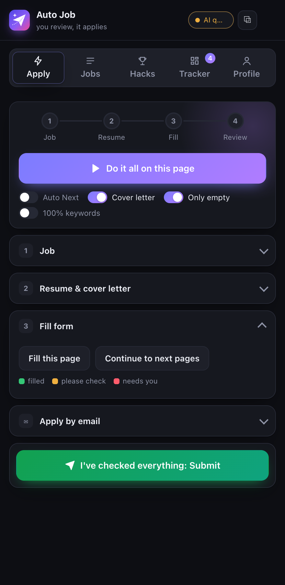<br><b>Apply</b>: one button runs Job → Resume → Fill → Review. Switches for auto-Next, cover letter, "only empty fields" and 100% keywords.</td>
<td width="50%">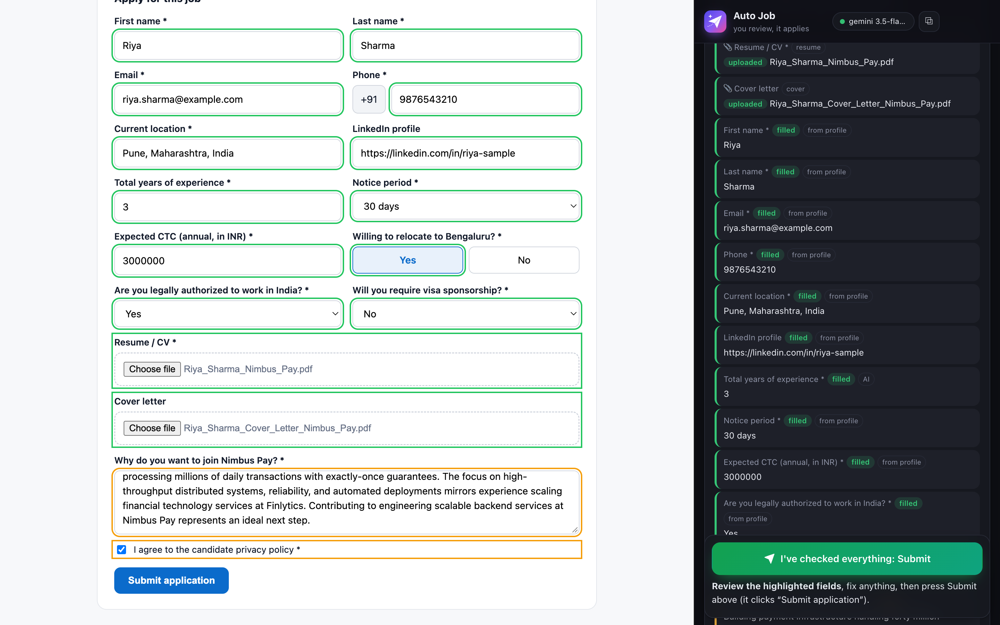<br><b>Fill results</b>: every field, its value, and where the value came from (profile, memory or AI). Anything that needs you is listed first.</td>
</tr>
<tr>
<td>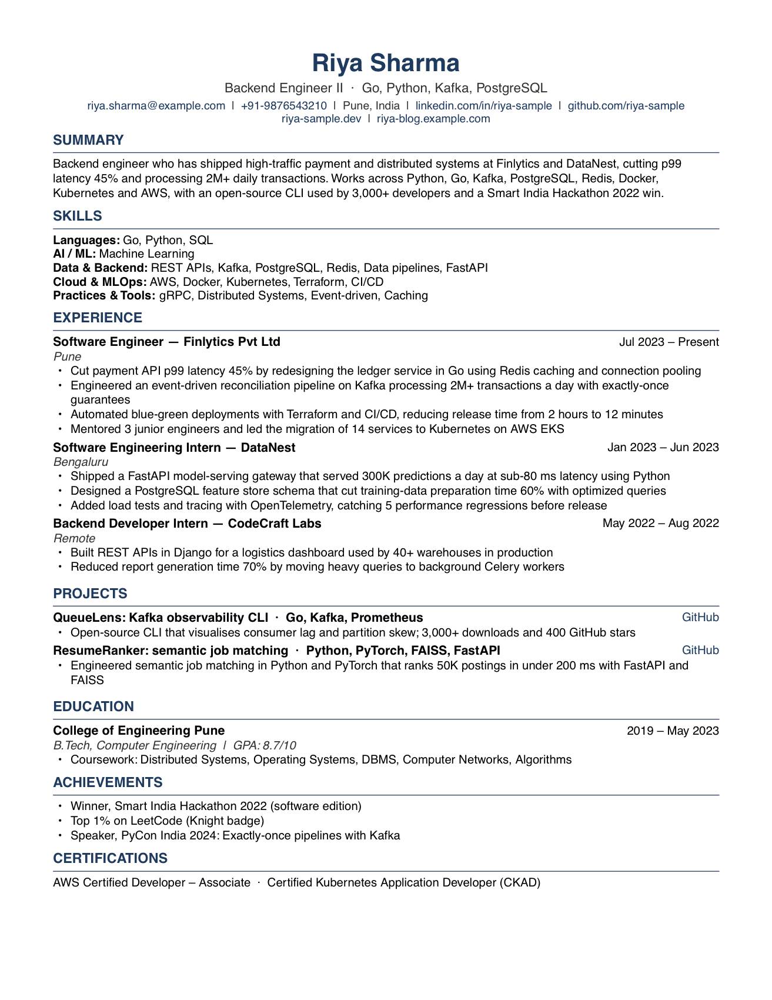<br><b>Tailored resume</b>: one page, single column, real text, clickable links, the job's title and keywords up top. Every number comes from your own resume.</td>
<td>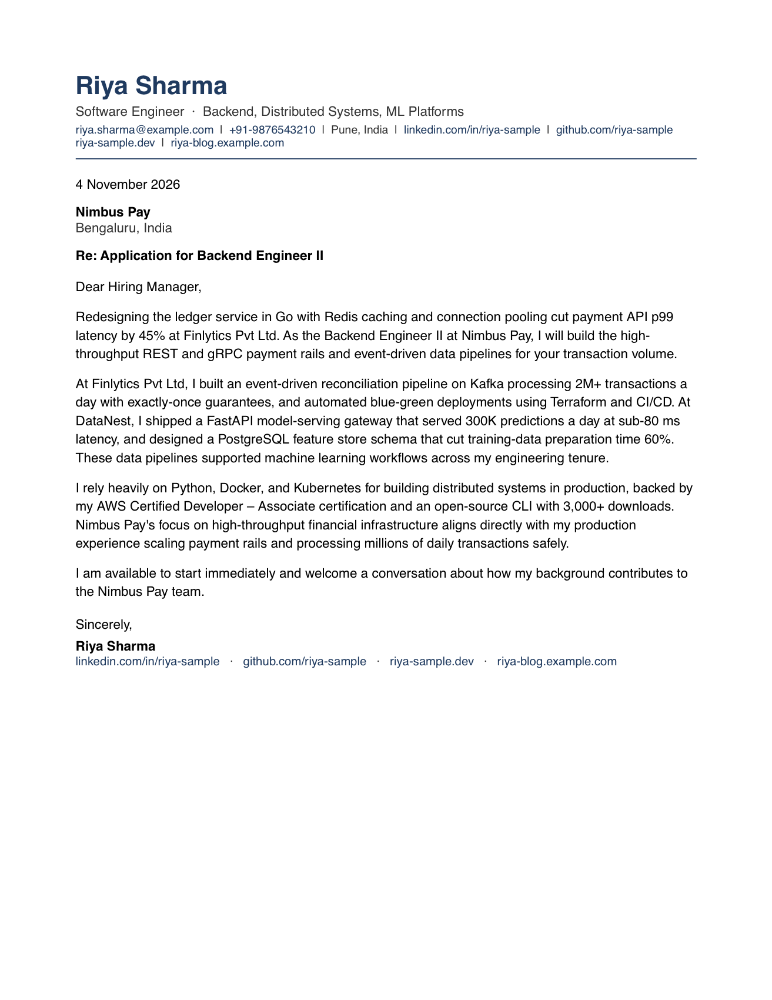<br><b>Cover letter</b>: opens with your most relevant result, proves fit with two achievements, closes with a call to action. No "I am writing to express my interest".</td>
</tr>
<tr>
<td>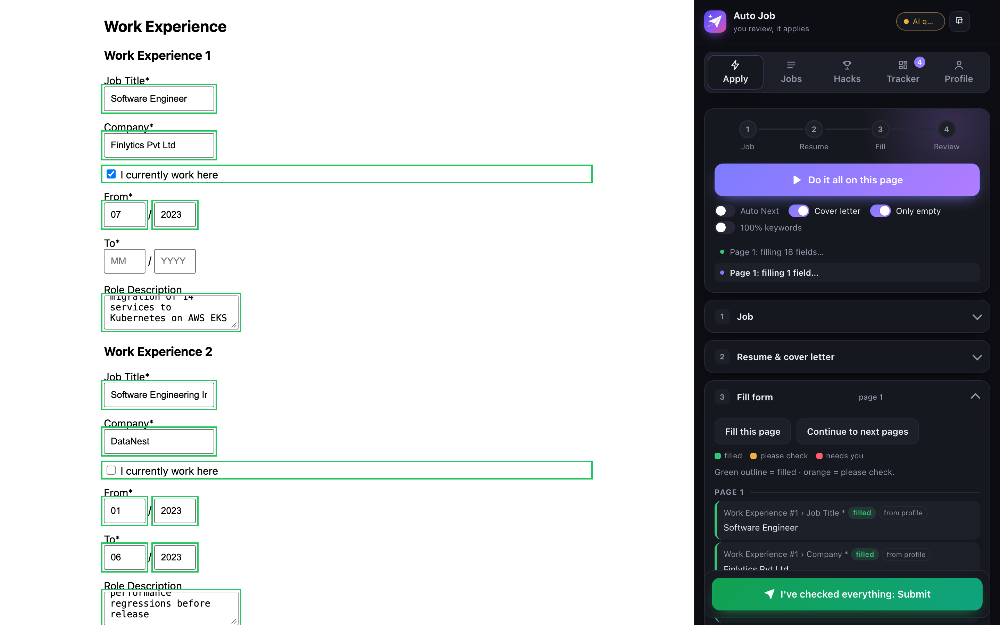<br><b>Workday-style pages</b>: Work Experience entries from your profile in order, split MM / YYYY date boxes, "I currently work here" ticked only for your current job.</td>
<td>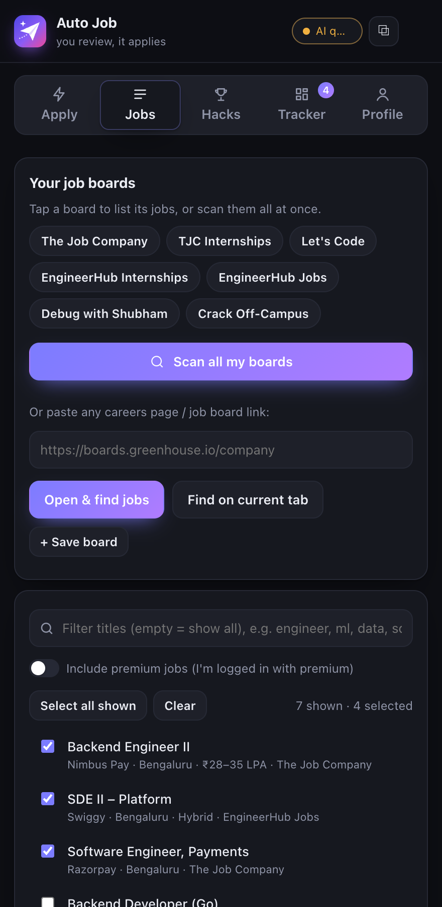<br><b>Jobs</b>: one-tap job boards. "Scan all my boards" merges every posting into one list; tick jobs and press <i>Start applying</i>.</td>
</tr>
<tr>
<td>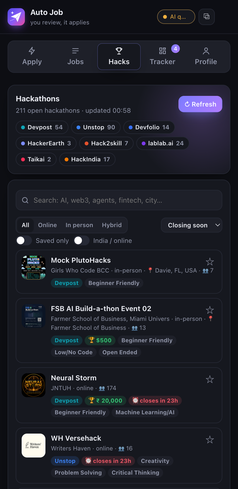<br><b>Hacks</b>: open hackathons from Devpost, Unstop, Devfolio, HackerEarth, Hack2skill, lablab.ai, Taikai and HackIndia, with prize, mode and deadline.</td>
<td>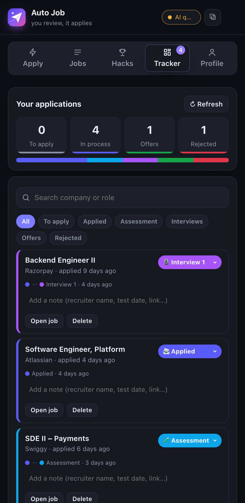<br><b>Tracker</b>: every application with its status, a timeline and notes. Counters for To apply / In process / Offers / Rejected.</td>
</tr>
<tr>
<td>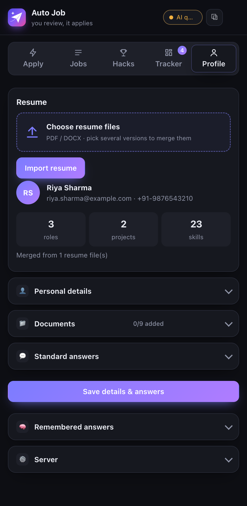<br><b>Profile</b>: import one or several resumes (merged into one master profile), personal details, documents, standard answers, remembered answers.</td>
<td>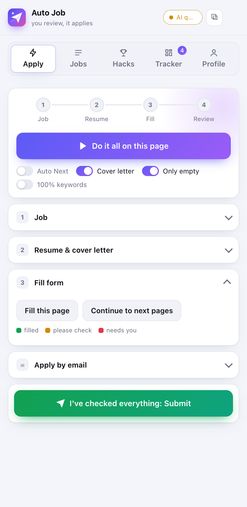<br><b>Light and dark</b>: follows your system theme. Runs as a side panel in Chrome / Edge / Brave, and as a popup, tab or window in Arc.</td>
</tr>
</table>

## How it works

### One press of "Do it all on this page"

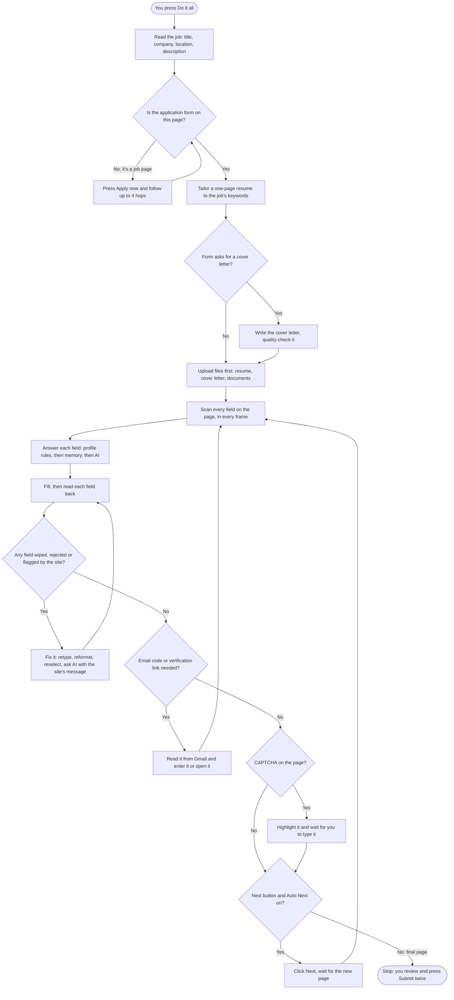

### The form-filling loop on each page

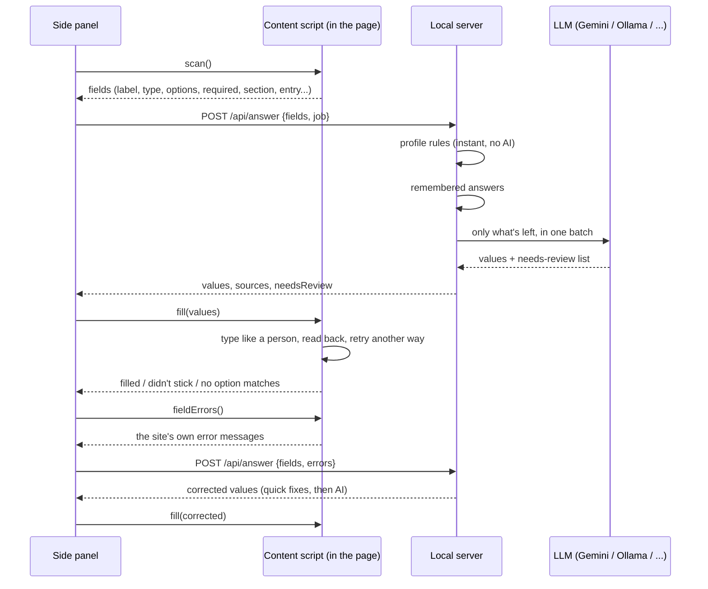

## Architecture

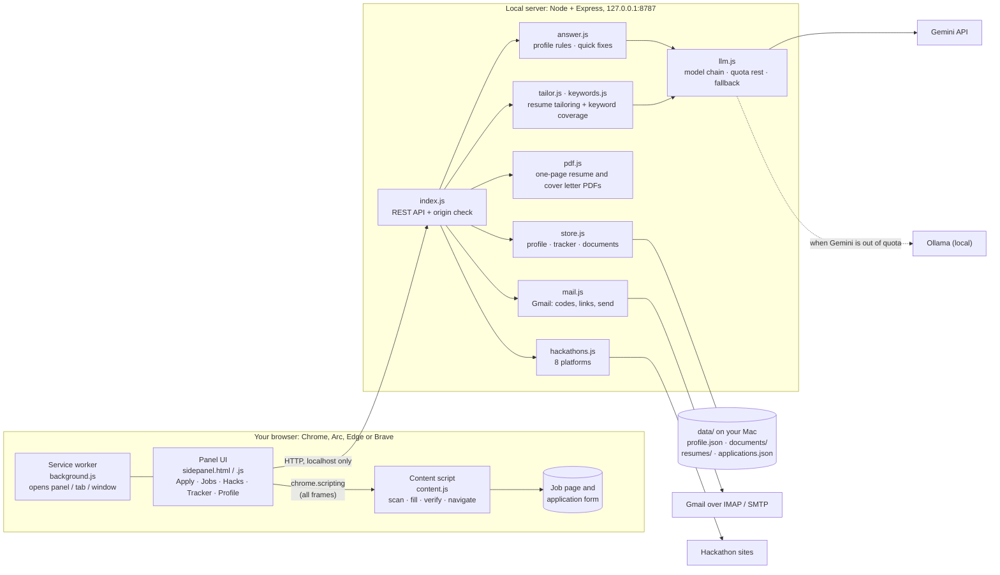

**Why a local server?** The panel can't keep secrets or write files safely. The server holds your API key and Gmail app password in `server/.env`, keeps your profile and documents on your own disk, renders PDFs, and talks to the AI. It listens on `127.0.0.1` only and refuses requests from other websites, so a page you visit can't read your profile.

### Which model answers what

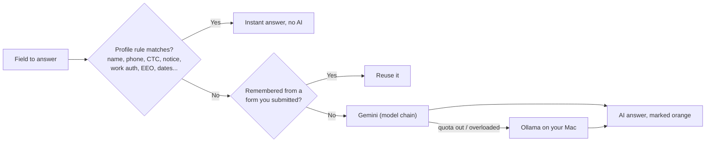

## Quick start

You need **Node.js 20+**, **Google Chrome or Arc**, and either a **Gemini API key** (free at [aistudio.google.com/apikey](https://aistudio.google.com/apikey)) or **[Ollama](https://ollama.com)** for a fully local model.

**1. Get the code and start the server**

```bash
git clone https://github.com/batmandevx/Auto-Job.git
```

```bash
cd Auto-Job/server && npm install
```

```bash
cp .env.example .env
```

Open `server/.env`, set `LLM_PROVIDER=gemini` and paste your key into `GEMINI_API_KEY=`. Then start it:

```bash
npm start
```

You should see `Auto Job server on http://localhost:8787`.

**2. Load the extension**

| Chrome / Edge / Brave | Arc |
|---|---|
| Open `chrome://extensions` | Open `arc://extensions` |
| Turn on **Developer mode** | Turn on **Developer mode** |
| **Load unpacked** → choose the `extension` folder | **Load unpacked** → choose the `extension` folder |
| Pin **Auto Job** and click it | Pin it from the puzzle-piece menu and click it |

**3. Import your resume**

Open the panel → **Profile** → **Choose resume files** → pick one or more resume versions (PDF / DOCX) → **Import resume**. Then fill **Personal details** and **Standard answers** once (notice period, expected CTC, work authorisation, and so on).

**4. Apply**

Open any job posting, press **Do it all on this page**, review the orange fields, and press **I've checked everything: Submit** twice.

> **Optional:** connect Gmail for one-time codes. Create an App Password at [myaccount.google.com/apppasswords](https://myaccount.google.com/apppasswords) (needs 2-Step Verification), then set `GMAIL_USER` and `GMAIL_APP_PASSWORD` in `server/.env` and restart. The panel header shows **gmail ✓**.

## Using every feature

### Apply tab

| Control | What it does |
|---|---|
| **Do it all on this page** | The whole flow: read the job → press Apply → tailor → cover letter → fill every page → stop at review. |
| **1 · Job** | Reads the posting (JSON-LD, page text, visible description only). You can edit title, company and location before tailoring. |
| **2 · Resume & cover letter** | Tailor on its own, see the keyword coverage, download the PDF, write a cover letter, or open **Apply by email**. |
| **3 · Fill form** | **Fill this page** (also presses *Apply now* first on a job page) and **Continue to next pages**. |
| **Auto Next** | Clicks Next / Continue / Save and Continue after each page. Never clicks the final Submit. |
| **Cover letter** | Writes and attaches a cover letter whenever the form asks for one (file or text box). |
| **Only empty** | Leaves alone what the site already filled, for example after "Autofill with resume". Boxes the site still flags as empty, and link boxes, are always fixed. |
| **100% keywords** | Puts job keywords you don't have yet on a visible "Familiar with / learning" line. Off by default. |
| **I've checked everything: Submit** | Press twice within 10 seconds. Only then does Auto Job click the site's Submit, add the job to your Tracker and remember your reviewed answers. |

**Colours on the page:** green = filled from your profile or memory · orange = AI-written, consent box or "please check" · red = needs you.

**Opening the panel in Arc:** clicking the icon opens Auto Job as a popup. For long runs press **⧉** → **Open beside this page** (use Arc Split View) or **Open in a window**. It keeps working on the last web page you used. In Chrome, **⧉ → Open side panel** docks it.

### Jobs tab: job boards and the queue

1. Tap a preset board (The Job Company, TJC Internships, Let's Code, EngineerHub, Debug with Shubham, Crack Off-Campus), or paste any careers page / Greenhouse / Lever board link and press **Open & find jobs**.
2. **Scan all my boards** opens each one and merges every posting into one list: *Role · Company · location · pay*.
3. Filter titles, tick the jobs you want (**Select all shown** helps), then press **Start applying**. Auto Job opens each job, applies, fills and waits for your review. **Skip this job** moves on.
4. **☆ Save to tracker** saves ticked jobs as *To apply*.
5. **+ Save board** keeps any link as a one-tap board.
6. **Copy Wellfound script:** copies a console script for Wellfound. Note that this script submits without review.

### Hacks tab

- Open hackathons from **Devpost, Unstop, Devfolio, HackerEarth, Hack2skill, lablab.ai, Taikai and HackIndia**, with prize, mode, location, team size, themes and deadline.
- **Search** (AI, web3, fintech, a city…), filter **Online / In person / Hybrid**, **India / online** only, **Saved only**, and sort by **closing soon**, **biggest prize** or **most popular**.
- Deadlines turn **red** under 24 hours and **amber** under 4 days. **☆** saves one to your shortlist.
- Results are cached for 30 minutes and kept on disk. If a platform is down, its last results stay and its chip shows "!".

### Tracker tab

- Statuses: **To apply → Applied → Assessment → Interview 1 / 2 / 3 → HR → Offer → Accepted**, plus **Rejected** and **Withdrawn**.
- Jobs you submit through Auto Job, or apply to by email, are added automatically as *Applied*, with the tailored resume's file name.
- Each card has a status dropdown, a timeline, notes (recruiter, test date, link) and **Open job**.
- Counters at the top filter the list. Search by company or role.

### Profile tab

- **Resume import:** pick several versions (for example an AI resume and a full-stack resume). They're merged into one master profile that keeps every distinct bullet. Manual edits you made survive a re-import.
- **Personal details:** DOB, gender, pronouns, marital status, parents' names, address, nationality, languages, 10th / 12th schooling. These are for forms that ask.
- **Documents:** photo, signature, 10th / 12th marksheets, ID proof, address proof, PAN, degree, transcript (PDF / PNG / JPG). Upload fields that ask for one get the right file. A "passport size photo" always gets your photo, never your ID.
- **Standard answers:** work authorisation, sponsorship, notice period (text and days), expected and current CTC (text and annual number), relocation, fresher status, EEO answers, how you heard about jobs, government employment.
- **Remembered answers:** answers from forms you reviewed and submitted, reused next time. Answers that change per job (salary, "why us", sponsorship) are never remembered.
- **Server:** change the server address if you don't run it on port 8787.

### Apply by email

When a post only gives an email address:

1. **Do it all** detects that and opens **Apply by email**, or you can open it from step 2.
2. It drafts a short, specific email: your strongest results for this job, your links, and "can start immediately".
3. It attaches the tailored resume and cover letter.
4. You edit anything, press **Send email** twice, and it sends from your Gmail and adds the job to the Tracker.

### Gmail: codes and verification links

- **Code fields:** one box or six separate boxes. Auto Job waits up to 2 minutes for the email, pastes the code and checks that every box holds its digit.
- **"Check your email" pages:** it finds the verification link and opens it, but only on the job site's domain, the company's domain or a known ATS. Anything else is shown to you as a link.
- **Read-only inbox access.** It never moves or deletes email. Sending only happens for **Apply by email**, after your two clicks.

## The form-filling engine

What makes it work on real portals and not only on simple forms:

| Problem on real sites | How Auto Job handles it |
|---|---|
| **Workday ignores pasted values** ("must have a value" next to text that's clearly there) | Types through the browser's own editing (`insertText`), so the site sees real typing with the cursor at the end, then sends the focus-out events React listens for. If a box is still flagged, it retypes it key by key. |
| **Workday split date boxes** | Recognises month / year / day sections and types `07` and `2026` into the right boxes. |
| **Workday prompts** (school, field of study, "How did you hear about us?") | Searches with Enter, tries shorter names and acronyms ("Vellore Institute of Technology" → "VIT University"), and walks nested lists (*Job Boards › LinkedIn*). Picks "Other" when the page says to. |
| **Custom dropdowns** (React-Select, MUI, vue-multiselect, "Search & Select" divs) | Opens the list, uses its search box, scrolls lazy lists, retries with the first word ("Chennai, Tamil Nadu" → "Chennai"), and closes every list so no option lands in the wrong field. |
| **Fuzzy options** | Scores options with synonyms: "India" beats "Indiana", B.Tech → Bachelor of Engineering → Bachelor's, "M" / "F" lists, "Yes, I agree." for agreements. |
| **Sites that rewrite the form after the resume upload** (PyjamaHR) | Uploads files first, then fills, then re-checks every field at the end and refills anything that was wiped. |
| **Repeating sections** | Adds Work Experience / Education / Language entries up to what your profile has. It fills editor boxes and presses their own *Add* / *Save*, and opens imported cards flagged "Fields to fix". |
| **Link rows** ("Work Link [+]", "Link 1 / 2 / 3") | Presses "+" for more boxes and fills both portfolios, LinkedIn and GitHub, always with full `https://` URLs. |
| **Phone with a separate country-code box** | Enters just the 10 digits. Phone extensions stay empty. |
| **Validation errors** | Reads each field's error and the page's error banner. Common fixes (digits only, date format, missing `https://`, length) are instant. Anything else goes back to the AI with the site's message and the rejected value. |
| **Hidden padding** (zero-width spaces in labels) | Strips it so the question is read correctly. |
| **Job page vs form** | Ignores the site's search box, menus and "Save job" toggles, presses *Apply now*, and never presses a form's own "Apply" submit button. |
| **CAPTCHAs** | Never guessed or solved. The box is highlighted, your cursor is put in it, and the run waits for you. |

**Built against real portals:** fixes came from live applications on Workday (U.S. Bank), Lever (Acron Aviation), Phenom (GE HealthCare), PyjamaHR, Recruit CRM and Indian job boards. Each has a matching test page in `server/test/`. Greenhouse, Ashby, SmartRecruiters, iCIMS and other ATS links are recognised, and every other site gets the same generic engine.

## Answers that never depend on the AI

These come straight from your profile in milliseconds, so they're right even when the AI quota is out:

| Question (any wording) | Answer |
|---|---|
| Name, email, phone, address, PIN, city, state, country, DOB, gender, pronouns, marital status, parents' names | From **Personal details** (dates in the format the question asks for) |
| LinkedIn, GitHub, portfolio, "Link 2", "Other website" | Your links, a different one per box |
| School, degree, field of study, CGPA, graduation month / year, 10th / 12th details | From your education (degree matched to the form's list) |
| Academic standing (Freshman … Senior year) | Worked out from your degree's start year |
| Notice period / "how soon can you join" | Text, or a number of days when the box wants days |
| Expected / current CTC | Text ("₹12–18 LPA") or a full number when the box wants one ("in INR", "mention full no") |
| Total experience (years / months), "I am a fresher" | From your standard answers |
| Legally authorised to work / visa sponsorship | From the job's country: Yes / No for India, the honest answer abroad |
| Willing to relocate / work from the posted location | Yes |
| Non-compete, younger than 18, former government employee | No |
| Family at the company, past work for the company or its consultants | No (Yes only if the company is in your experience) |
| How did you hear about us? | LinkedIn → company website → job board, whichever the list has |
| Languages and proficiency | Each language, native or fluent |
| Work Experience #n fields | Your n-th role: title, company, location, dates, "currently work here", bullet points |
| Race, veteran status, disability status | Your saved answers |
| Consent and declaration boxes | Ticked, and marked orange for you to check |

## The resume and cover letter

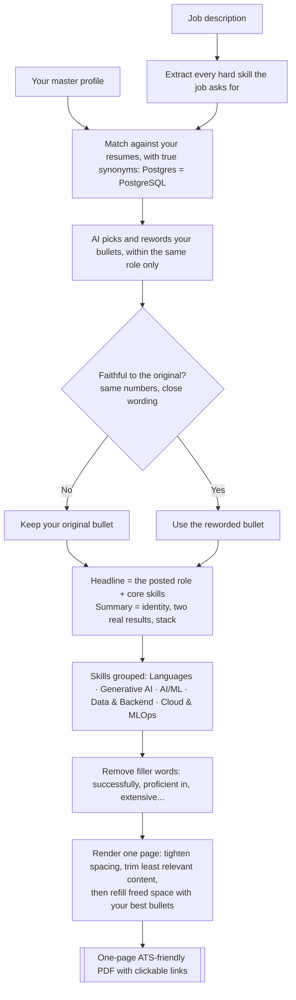

- **ATS-friendly by design:** a single column, real selectable text in a standard font, no tables, images or text boxes, standard section names, and the posted job title in the headline.
- **Keyword coverage:** every job keyword you genuinely have appears in the job's own spelling. Keywords you don't have are listed so you can add them if they're true (tap a **+ chip**), or put on a "Familiar with / learning" line with the 100% switch.
- **Bullets with rhythm:** action verb → what you built → the tools the job asks for → the real result. No two bullets in a role start with the same verb.
- **Cover letters with a quality check:**
  - 250–330 words in four paragraphs: hook, proof, fit, close.
  - It's checked for length, paragraph count and stock phrases ("I am writing to express", "leveraging", "proves my ability"…). If it fails, the AI is told exactly what to fix and rewrites it once.
- **Your rules:** no graduation year or "student" timing in the summary, cover letter or written answers, and "can start immediately".

## How it stays honest

- **Nothing is invented.** The AI can only choose and reword bullets within the same job. The server rejects any rewrite that adds or changes a number, or drifts too far from your original. Skills you never listed are dropped.
- **Facts come from your profile, not from the AI.** If a fact is missing (say a salary you never entered), the field is left empty and flagged.
- **Everything the AI wrote is orange.** So are consent boxes and anything Auto Job isn't sure about.
- **You submit.** The final Submit needs two clicks from you. Only answers you reviewed and submitted are remembered.
- **CAPTCHAs and passwords stay with you.** Password fields are never filled, and CAPTCHAs are never solved.

## Privacy and security

- **Your data stays on your Mac.** The `data/` folder holds your profile, documents, tracker and every generated PDF. It's in `.gitignore` and never leaves your machine, except as the text sent to the AI provider you choose. Use Ollama to keep even that local.
- **Secrets live in `server/.env`** (git-ignored): your AI key and Gmail app password. The panel never sees them.
- **Localhost only:** the server binds to `127.0.0.1` and accepts requests only from the extension and localhost pages. Other websites can't write to it.
- **Gmail is read-only** except for **Apply by email**, which sends only after your two clicks. Revoke access any time by deleting the App Password.
- **Verification links** are opened only on the job site's domain, the company's domain or a known ATS.

## Configuration

All settings live in `server/.env` (copy `server/.env.example`):

| Setting | Default | What it does |
|---|---|---|
| `PORT` | `8787` | Server port (change it in Profile → Server too) |
| `LLM_PROVIDER` | `ollama` | `gemini`, `ollama`, `openai` (any OpenAI-compatible API) or `anthropic` |
| `GEMINI_API_KEY` | — | Your Gemini key |
| `GEMINI_MODEL` | `gemini-3.5-flash-lite` | Fast model for form answers |
| `GEMINI_HEAVY_MODEL` | `gemini-3.5-flash` | Resume import, tailoring and cover letters |
| `GEMINI_FALLBACK_MODELS` | several | Tried in turn when a model is out of quota or overloaded |
| `OLLAMA_MODEL` / `OLLAMA_URL` | `qwen3.5:9b` / `localhost:11434` | Local model, also the automatic fallback when Gemini fails |
| `OLLAMA_FALLBACK` | on | Set to `off` to disable the Ollama fallback |
| `OPENAI_BASE_URL` / `OPENAI_MODEL` / `OPENAI_API_KEY` | — | Any OpenAI-compatible provider (OpenAI, Groq, LM Studio…) |
| `ANTHROPIC_MODEL` / `ANTHROPIC_API_KEY` | — | Claude |
| `GMAIL_USER` / `GMAIL_APP_PASSWORD` | — | Gmail for codes, verification links and Apply by email |

**Gemini free tier:** about 20 requests per model per day. The server rotates through your fallback models, rests the ones that are out of quota until the daily reset, and falls back to Ollama if all are out. The panel's status pill shows **AI quota low** or **local AI (Gemini quota out)**. One application uses roughly 3–6 requests.

## Server API

All endpoints are on `http://localhost:8787` and accept JSON.

| Method | Path | Purpose |
|---|---|---|
| GET | `/api/health` | Status: model, Gmail, profile, quota |
| POST | `/api/profile/import` | Import and merge resume files (multipart `resume`) |
| GET / PUT | `/api/profile` | Read or save your profile |
| POST | `/api/profile/skills` | Add skills you confirmed (+ chips) |
| POST | `/api/tailor` | Tailored resume PDF + keyword coverage for a job |
| POST | `/api/cover-letter` | Cover letter text + PDF for a job |
| POST | `/api/answer` | Values for a list of form fields (with optional site errors) |
| POST | `/api/answer-bank` | Remember answers from a submitted form |
| GET / POST / DELETE | `/api/documents[/:kind]` | List, upload, fetch or remove documents |
| POST | `/api/email/draft` · `/api/email/send` | Draft and send an application email |
| GET | `/api/email/check` · `/api/mail/status` | Gmail connection status |
| GET | `/api/otp` | Wait for a one-time code or verification link |
| GET | `/api/hackathons` | Open hackathons from 8 platforms |
| GET / POST / PATCH / DELETE | `/api/applications[/:id]` | The tracker |

## Project structure

```
Auto-Job/
├── extension/                 Chrome MV3 extension
│   ├── manifest.json
│   ├── background.js          opens the panel as side panel, popup, tab or window
│   ├── launcher.html/.js      "how should it open?" chooser
│   ├── sidepanel.html/.css/.js  the panel: Apply, Jobs, Hacks, Tracker, Profile
│   ├── content.js             the form engine: scan, fill, verify, navigate
│   └── scripts/               Wellfound console script
├── server/
│   ├── src/
│   │   ├── index.js           REST API, origin check
│   │   ├── answer.js          profile rules, quick fixes, AI batching
│   │   ├── tailor.js          resume tailoring, skill groups, filler removal
│   │   ├── keywords.js        job keyword extraction and coverage
│   │   ├── pdf.js             one-page resume and cover letter PDFs
│   │   ├── prompts.js         every AI prompt
│   │   ├── llm.js             Gemini / Ollama / OpenAI / Claude, quota handling
│   │   ├── mail.js            Gmail IMAP / SMTP
│   │   ├── hackathons.js      8 hackathon platforms
│   │   └── store.js           profile, documents, tracker on disk
│   ├── test/                  test forms that copy real portals
│   └── .env.example
├── docs/screenshots/          the images in this README (made-up demo profile)
└── data/                      your data, git-ignored, created on first run
```

## Testing without a real job

With the server running, open any of these and use the panel on it:

| Page | What it exercises |
|---|---|
| `/test/form.html` | A simple one-page form |
| `/test/hard.html` | A 4-step form with custom widgets, uploads and validation |
| `/test/tricky.html` | Workday-style lists, lazy scrolling, validation errors |
| `/test/recruitcrm.html` | "Search & Select" dropdowns and agreement questions |
| `/test/sections.html` | Repeating sections, tag inputs, staged questions |
| `/test/pyjama.html` | Link rows with "+", a resume upload that wipes the form |
| `/test/fixcard.html` | Imported cards flagged "Fields to fix" |
| `/test/langs.html` | Add Language editors and Link 1 / 2 / 3 boxes |
| `/test/workday.html` · `/test/wdexp.html` · `/test/wdstate.html` | Workday prompts, split dates, values Workday ignores unless typed |
| `/test/juspay.html` | Phone with a separate +91 box, CAPTCHA hand-off |
| `/test/jobpage.html` | A job page with a search box and "Save job" before "Apply now" |
| `/test/otp.html` · `/test/oracle.html` | One-time codes and 6-box inputs |

All paths are on `http://localhost:8787`.

## Troubleshooting

| Symptom | Fix |
|---|---|
| Panel says **server offline** | Run `npm start` in `server/`. If it says the port is in use, an earlier server is still running, which is fine. |
| Many fields left empty, status pill amber | The Gemini daily quota is used up. Start Ollama (`ollama serve`) for the automatic local fallback, wait for the reset, or add billing to the key. |
| Arc: clicking the icon does nothing visible | Use the popup, then **⧉ → Open in a window** or **Open beside this page**. Reload the extension after updating. |
| A site shows "required" next to filled boxes | Reload the extension (0.8.8+) and press Fill again. Auto Job retypes boxes the site still calls empty. |
| A dropdown says "no option matches" | Pick it yourself. The panel lists the field and the value it tried. |
| Old values stay after a fix | Turn off **Only empty**, or clear the field, then press Fill again. |
| Changes to the code don't show | Reload the extension at `chrome://extensions` (or `arc://extensions`) and restart the server. |

## Limits

- **CAPTCHAs and passwords** are yours to type. Auto Job highlights CAPTCHAs and never fills password fields.
- **Unusual widgets** (drag-to-rank, canvas date pickers) may need a click. They're listed as "pick it yourself".
- **LinkedIn / Indeed terms** restrict automation. Auto Job fills for your review and never submits on its own.
- **The AI can be wrong** on open-ended questions. That's why those answers are orange: read them before you submit.

---

<div align="center">

Built by **[Ayush Upadhyay](https://github.com/batmandevx)**. If Auto Job saves you an evening of applications, a ⭐ helps others find it.

</div>
